<!-- Animated header -->
<div align="center">
  
</div>

<div align="center">
  <a href="https://git.io/typing-svg">
    
  </a>
</div>



<div align="center">


[](https://www.linkedin.com/)
[](mailto:sroshans025@gmail.com)

</div>

---

## 🐶 About me

```python
class Roshan:
    role      = "AI & ML Engineer Intern @ Infyro"
    studying  = "B.E. CSE (AI & ML) @ Chennai Institute of Technology, CGPA 8.15"
    location  = "Pudukkottai, Tamil Nadu, India"
    languages = ["English", "Tamil"]
    leads     = "Secretary, Team Yuvenza (Youth Club of CIT)"
    interests = ["Machine Learning", "Backend & APIs", "Nature", "Dogs (cynophilist 🐕)"]

    def goal(self):
        return "Build, train and ship ML-powered products end to end"
```

- 🔭 I build predictive ML systems and the backends that serve them
- 🌱 Currently learning: **PyTorch, Next.js, Docker, MLOps (MLflow, DVC)**
- 🤝 As Secretary of **Team Yuvenza** I mentor members, set milestones and unblock events
- 🐾 Biophilia & cynophilist studies: nature and animal behaviour are my happy place


## 🛠️ Tech stack

**Languages**

<p>
  
</p>

**Backend, Web & Databases**

<p>
  
</p>

**ML & Data**

<p>
  
  
  
  
  
</p>

**Tools, Cloud & DevOps**

<p>
  
</p>

<details>
<summary>📚 Core concepts</summary>

Data Structures & Algorithms • Database Management • Web Development • Supervised Learning • REST APIs • Automation

</details>


## 🚀 Projects

| Project | What it does | Stack |
| :-- | :-- | :-- |
| 🌫️ **AirRisk Prediction** | Predicts atmospheric risk levels and PM2.5 pollutant concentrations | `Python` `Machine Learning` |
| 🩺 **HealthRisk Prediction** | Classifies patient health risk from clinical parameters and historical data | `Python` `Scikit-Learn` |
| ✉️ **PyMail** | Automation tool for sending personalized emails with attachments | `Python` `SMTP` |
| 🏦 **AgentLend AI** | Backend managing persistent loan states, background workers and real-time dashboard updates | `Python` `FastAPI` `SQLAlchemy` `WDK` |

> 🔗 Add repo links to each project name once they are public, for example `[AirRisk Prediction](https://github.com/sroshans025/<repo>)`.

## 💼 Experience & leadership

- **AI & ML Engineer Intern**, Infyro
- **Machine Learning Researcher & Developer**: built the AirRisk and HealthRisk systems with supervised learning, and researched key environmental variables to make air-index prediction more reliable
- **Secretary, Team Yuvenza** (Youth Club of CIT): mentored members, defined project milestones and resolved logistical bottlenecks to improve event quality and student engagement

## 🎓 Certifications


## 📊 GitHub stats

<div align="center">
  
  
</div>

<div align="center">
  
</div>

<div align="center">
  
</div>

## 🤝 Let's connect

I'm looking for an entry-level **AI/ML** role where I can build impactful products with a forward-thinking team. If you have an idea, a bug, or a good dog photo, reach out.

<div align="center">

[](mailto:sroshans025@gmail.com)
[](https://www.linkedin.com/)


</div>
