a

## ⚡ Recruiter quick view

<table>
<tr>
<td width="33%" valign="top">

### 🧠 Builds ML
Supervised models for **air-quality** and **health-risk** prediction, from data to evaluation.

</td>
<td width="33%" valign="top">

### 🚀 Ships backends
**FastAPI + SQLAlchemy** services with background workers and real-time dashboards.

</td>
<td width="33%" valign="top">

### 🤝 Leads people
**Secretary of Team Yuvenza**: mentors members, sets milestones, unblocks events.

</td>
</tr>
</table>

## 🐶 About me

<table>
<tr>
<td valign="middle">

👋 **Hi, I'm Roshan**, a **B.E. CSE (AI & ML)** student at **Chennai Institute of Technology** with a CGPA of **8.15**.

💼 **AI & ML Engineer Intern** at Infyro, building predictive models and the APIs that serve them.

🎯 **Goal:** build, train and ship ML-powered products end to end.

🌱 **Learning now:** PyTorch · Next.js · Docker · MLOps (MLflow, DVC)

🐕 **Off the keyboard:** biophilia and cynophilist studies. Nature, animal behaviour, and border collies.

🗣️ **Languages:** English · Tamil

</td>
<td align="center" valign="middle" width="300">

</td>
</tr>
</table>

## 🛰️ Tech universe

 
 

## 🚀 Featured projects

<table>
<tr>
<td width="50%"></td>
<td width="50%"></td>
</tr>
<tr>
<td width="50%"></td>
<td width="50%"></td>
</tr>
</table>

## 🧭 Journey

<b>💼 Experience details</b>

 

- **AI & ML Engineer Intern**, Infyro
- **Machine Learning Researcher & Developer**: built the AirRisk and HealthRisk systems with supervised learning on environmental and health datasets for early risk assessment, and researched key environmental variables to make air-index prediction more reliable
- **Secretary, Team Yuvenza** (Youth Club of CIT): mentored members, defined project milestones and resolved logistical bottlenecks to improve event quality and student engagement

## 🎓 Certifications

## 📊 GitHub stats

## 🤝 Let's build something

I'm looking for an entry-level **AI/ML** role on a team that ships real products. I bring ML fundamentals, backend engineering and leadership, plus a border collie's work ethic.

  

